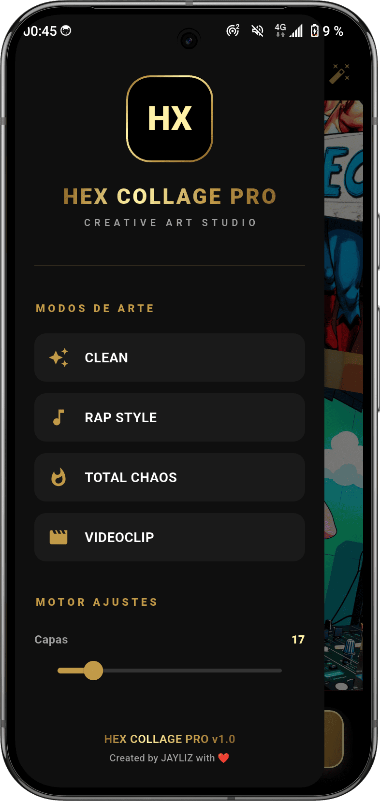
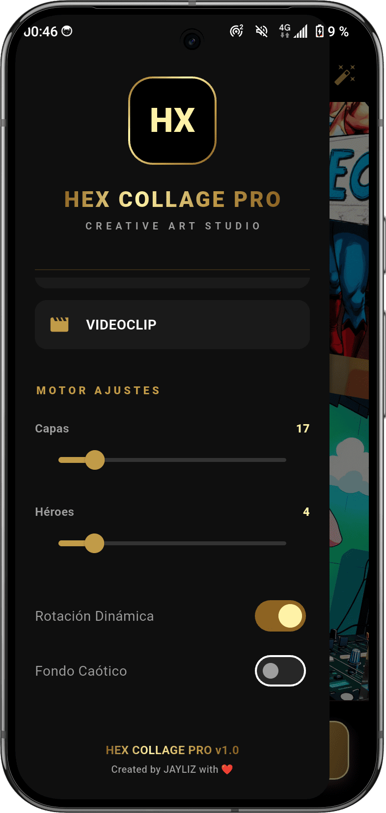

# 🎨 HexCollage Pro ✨    

**HexCollage Pro** es una aplicación móvil de estudio de arte creativo desarrollada en **Flutter**, diseñada para generar collages y composiciones visuales dinámicas con una interfaz fluida y un elegante diseño de temática oscura y dorada

<a href="https://github.com/Jaypsmall/HexCollagePro/releases/download/flutter/HexCollagePro_v1.0.flutter.apk">

</a>

---

## 🚀 Características Principales

* **Estudio de Importación:** Acceso rápido a las fotos y álbumes del dispositivo para seleccionar las imágenes que formarán parte del collage
* **Modos de Arte:** Diversos estilos preconfigurados para adaptar el diseño de las composiciones:
  * *Clean*
  * *Rap Style*
  * *Total Chaos*
  * *Videoclip*
* **Motor de Ajustes Avanzado:** Personalización detallada de los parámetros de la obra
  * Control de número de **Capas**
  * Control de cantidad de **Héroes**
  * Activación de **Rotación Dinámica**
  * Activación de **Fondo Caótico**
* **Exportación Rápida:** Botón dedicado para exportar el resultado final de forma inmediata

---

<p align="center">
  
  
  
</p>

---

## 🛠️ Tecnologías Utilizadas

* **Framework:** [Flutter]
* **Lenguaje:** Dart

<p align="center">
  <a href="https://kotlinlang.org" target="_blank"></a> &nbsp;&nbsp;
  <a href="https://flutter.dev" target="_blank"></a> &nbsp;&nbsp;
  <a href="https://dart.dev" target="_blank"></a>
</p>

---

## 📱 Instalación y Ejecución

1. Clona este repositorio:
   ```bash

   git clone https://github.com/Jaypsmall/HexCollagePro.git

---

## 📄 Licencia & Copyright

Copyright © 2026. Todos los derechos reservados. El código fuente de esta aplicación es propiedad privada del desarrollador. Se prohíbe la reproducción, distribución o modificación no autorizada de este software. 

Desarrollado con 🧡 por un desarrollador independiente. 
**Jaypsmall**
